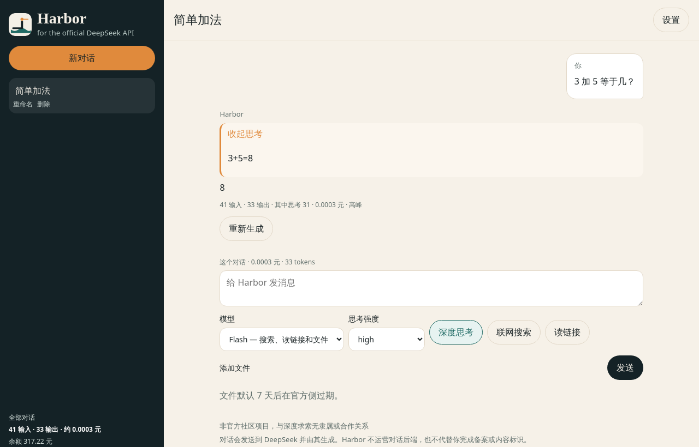

# Harbor

Unofficial community project, not affiliated with DeepSeek.

Harbor is an open-source (MIT) chat client for the [official DeepSeek API](https://platform.deepseek.com/). You bring your own key. The key and the conversations stay in this browser. The page is static: it does not send them to Harbor, and `https://hfd.linkos.org` does not run a chat backend.

Harbor is an unofficial open-source community project by openlinkos. It is not affiliated with, endorsed by, or sponsored by DeepSeek. DeepSeek is a trademark of its owner and is used here only to describe API compatibility.



## What it does

- Streams replies from `deepseek-flash` and `deepseek-v4-pro`, including the reasoning text.
- On Flash: web search, link reading, file upload (files expire on the official side, 7 days by default), and an automatic title.
- Several conversations, rename, delete, stop, and regenerate (kept as a branch).
- Markdown, highlighted code, KaTeX math, and Mermaid.
- Chinese and English. The layout works on a phone and can be installed as a PWA.
- Per-conversation and total usage, estimated from the `usage` object in the stream. Official balance from `GET /user/balance`. There is no official usage-history API.
- `safety_check` is `high` by default.
- Export and import a versioned JSON archive. Import merges by conversation id and does not replace chats you already have. A v3 ZIP follows the official archive shape for the fields it can represent.

A self-hosted server is described in [docs/self-host.md](docs/self-host.md). Android and iOS are Capacitor shells of this same page: the key stays on the device, and a server address is optional. See [docs/android.md](docs/android.md) and [docs/ios.md](docs/ios.md).

## Privacy

| | |
|---|---|
| Key | IndexedDB on this device. Optional passphrase (PBKDF2-SHA-256 + AES-256-GCM). Never in `localStorage` or the URL. |
| Chats | IndexedDB on this device. |
| Requests | The browser calls `https://api.deepseek.com` with `credentials: "omit"`. |
| This website | Static files only. No account, no analytics. |

A key in a browser can be read by a malicious extension or by a script injection. The platform terms say not to put a key in client-side code. Use a dedicated key with a spending limit if you use the public page. Details: [SECURITY.md](SECURITY.md).

Messages are sent to DeepSeek, which generates the reply. Harbor does not file or label on your behalf.

## Quick start

Node.js 22 and pnpm 10.

```bash
pnpm install
pnpm dev
```

Open <http://127.0.0.1:5173>, paste a key from <https://platform.deepseek.com/api_keys>, and send a message.

```bash
pnpm build   # static files in apps/web/dist
pnpm preview
```

Deployment of the static site, including Cloudflare Pages: [docs/deploy.md](docs/deploy.md).

## Android

The app is the same interface. Chat still goes to `https://api.deepseek.com` unless you type a Harbor server you run and log in. Export and import use the share sheet. Pull requests build a debug APK. A `v*` tag attaches an APK to the GitHub Release, signed only when the keystore secrets exist. Details: [docs/android.md](docs/android.md). The iOS shell is the same app. Pull requests build an unsigned simulator app. TestFlight is documented and is not signed in CI: [docs/ios.md](docs/ios.md).

## Self-hosting

`docker compose pull && docker compose up -d` pulls `ghcr.io/openlinkos/harbor-for-deepseek` and starts Postgres plus one app container. Nothing has to be set in the environment. The first page creates an admin, who adds API keys, invite codes, and per-person daily quotas. Friends log in on that same address. Details, the optional variables, and backup steps: [docs/self-host.md](docs/self-host.md).

If the official API later stops sending CORS headers, the static page will stop working. A proxy is not included. Do not add one on the public host without saying so.

## Development

```bash
pnpm lint
pnpm typecheck
pnpm test
pnpm e2e
```

Tests mock the API. They use the redacted response shapes from the design notes. Do not commit a key.

The interface is new. Protocol behavior and the v3 archive follow the public API and the layout documented by [deepseek-ai/chat-demo](https://github.com/deepseek-ai/chat-demo) (MIT, `Copyright (c) 2026 DeepSeek`). That license is in [NOTICE](NOTICE). MIT does not grant trademark rights.

## License

[MIT](LICENSE) © 2026 OpenLinkOS
