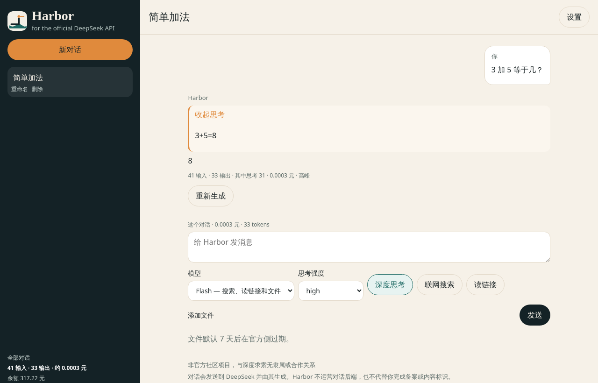

# DeepAPI

[English](README.md)


DeepAPI 是面向 [DeepSeek API](https://platform.deepseek.com/) 的开源（MIT）对话客户端。你使用自己的 Key。Key 和对话都留在这台浏览器里。页面是静态的：它们不会发给 DeepAPI，`https://deepapi.linkos.org` 也不运行对话后端。



## 两种用法

**轻量。** 打开 [deepapi.linkos.org](https://deepapi.linkos.org)，或自己构建静态页。Key 和对话留在这台设备上，可以导出和导入。这种用法没有服务器。

**服务器。** 可选。`docker compose up` 会在你自己的机器上启动 PostgreSQL 和一个应用容器。管理员添加 Key 池、查看余额、发出邀请账号。登录的人可以在多台设备上同步对话。见 [docs/self-hosting_cn.md](docs/self-hosting_cn.md)。

## 填入 Key

1. 打开 <https://deepapi.linkos.org>。
2. 在 <https://platform.deepseek.com/api_keys> 创建一个 Key。实际使用时，用设了额度的专用 Key。
3. 粘贴到页面里，确认页面上的说明，保存在这台设备上。
4. 发送一条消息。浏览器直接请求 `https://api.deepseek.com`。

## 功能

- 流式对话，模型为 `deepseek-flash` 与 `deepseek-v4-pro`，可显示思考过程。
- Flash 上可用：联网搜索、打开网页、文件上传（文件会保留）、自动标题。
- 多个对话，重命名、删除、停止、重新生成（保留为分支）。
- Markdown、代码高亮、KaTeX 公式、Mermaid。
- 中文和英文界面，手机上可用，可安装为 PWA。
- 按流式响应里的 `usage` 估算每个对话和累计用量，并用 `GET /user/balance` 显示官方余额。官方不提供用量历史。
- `safety_check` 默认 `high`。
- 导出自有 JSON（带版本号）。导入按对话 id 合并，不覆盖已有对话。v3 ZIP 按官方归档的形状交换它能表达的字段。

自部署服务器见 [docs/self-hosting_cn.md](docs/self-hosting_cn.md)。Android 和 iOS 是同一页面的 Capacitor 壳：Key 留在设备上，服务器地址可选。见 [docs/android.zh-CN.md](docs/android.zh-CN.md) 和 [docs/ios.zh-CN.md](docs/ios.zh-CN.md)。

## 隐私

| | |
|---|---|
| Key | 存在本机的 IndexedDB。可以设口令（PBKDF2-SHA-256 + AES-256-GCM）。不进 `localStorage`，也不进网址。 |
| 对话 | 存在本机的 IndexedDB。 |
| 请求 | 浏览器直连 `https://api.deepseek.com`，`credentials: "omit"`。 |
| 这个网站 | 只有静态文件。没有账号，没有统计。 |

浏览器里的 Key 可能被恶意扩展或脚本注入读到。开放平台协议要求不要把 Key 放进客户端。使用公开页面时，建议用设了额度的专用 Key。细节见 [SECURITY.md](SECURITY.md)。

对话会发给 DeepSeek，并由对方生成回复。DeepAPI 不代替你做备案或内容标识。

## 快速开始

需要 Node.js 22 和 pnpm 10。

```bash
pnpm install
pnpm dev
```

打开 <http://127.0.0.1:5173>，填入 <https://platform.deepseek.com/api_keys> 的 Key，然后发送消息。

```bash
pnpm build   # 静态文件在 apps/web/dist
pnpm preview
```

静态站的部署，包括 Cloudflare Pages，见 [docs/deploy.md](docs/deploy.md)。

## Android

应用是同一套界面。不填写你自己的 DeepAPI 服务器时，对话仍然直接发往 `https://api.deepseek.com`。导出和导入使用系统分享。每个拉取请求会构建调试 APK。打上 `v*` 标签时，把 APK 附到 GitHub Release；只有密钥库密钥都配置了才会签正式包。说明见 [docs/android.zh-CN.md](docs/android.zh-CN.md)。iOS 是同一个应用。拉取请求会构建未签名的模拟器应用。TestFlight 只写在文档里，CI 不签名：见 [docs/ios.zh-CN.md](docs/ios.zh-CN.md)。

## 自托管

把 `.env.example` 复制为 `.env`，填上 `POSTGRES_PASSWORD`、`KEY_ENCRYPTION_SECRET` 和第一位管理员。然后 `docker compose up -d` 会从 `ghcr.io/openlinkos/deepapi` 启动 Postgres 和应用容器。管理员添加 API Key、邀请码和每人每天的额度。朋友在这个地址登录。说明见 [docs/self-hosting_cn.md](docs/self-hosting_cn.md)。

如果官方 API 以后不再返回 CORS 头，静态页面会无法直连。这一版没有代理。不要在公开站点上悄悄加一个。

## 开发

```bash
pnpm lint
pnpm typecheck
pnpm test
pnpm e2e
```

测试使用模拟的 API 响应，结构来自设计说明里脱敏后的样例。不要把 Key 提交进仓库。

界面是重新做的。协议行为和 v3 归档参照公开 API，以及 deepseek-ai/chat-demo 文档中的归档结构。见许可证一节。

## 许可证

[MIT](LICENSE) © 2026 OpenLinkOS

`pnpm build` 会把 [LICENSE](LICENSE) 和 [NOTICE](NOTICE) 复制到 `apps/web/dist`。协议行为和 v3 归档参照公开 API，以及 [deepseek-ai/chat-demo](https://github.com/deepseek-ai/chat-demo)（MIT，`Copyright (c) 2026 DeepSeek`）文档中的归档结构。该版权和许可证在 NOTICE。DeepAPI 不使用该项目的名称、标志或字标。MIT 不授予商标权。

---

DeepAPI · [OpenLinkOS](https://openlinkos.com/zh/) 发起的开源项目

[GitHub](https://github.com/openlinkos/deepapi) · [许可证](LICENSE) · [OpenLinkOS](https://openlinkos.com/zh/)

DeepSeek 是其所有者的商标。本项目与深度求索没有隶属关系。
