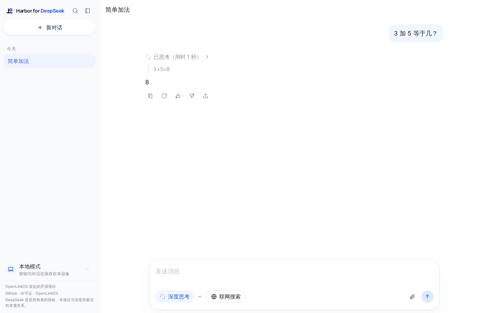
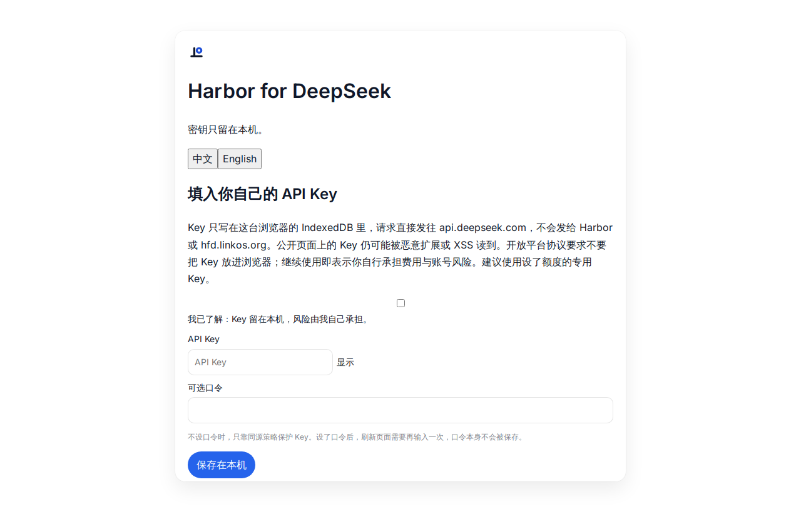
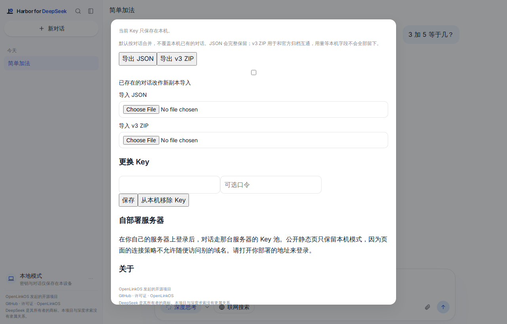

# [Harbor for DeepSeek](https://hfd.linkos.org)

Harbor for DeepSeek is a chat client for the DeepSeek API. You bring your own key.

## Features

### Lightweight mode

Open [hfd.linkos.org](https://hfd.linkos.org), or serve the static build yourself. The key and the messages stay on the device. Export and import are local. This mode has no server.

### Server mode

Optional. Docker and PostgreSQL run a server you host. An admin keeps a key pool, sees balance, and creates invite accounts. People who sign in can sync chats across devices.

## Screenshots

The chat, with reasoning open:

Where you paste the API key:

Replacing the key in Settings:

## Integrate with DeepSeek API

1. Open <https://hfd.linkos.org>.
2. Create a key at <https://platform.deepseek.com/api_keys>. Use a spending limit.
3. Paste the key on the first page and save it on this device.
4. Send a message. The browser calls `https://api.deepseek.com`.

For the server you host: `docker compose pull && docker compose up -d`, create the admin on the first page, add keys to the pool, and share an invite code.

## Links

- Homepage: <https://hfd.linkos.org>
- GitHub: <https://github.com/openlinkos/harbor-for-deepseek>
- License: MIT

---

Harbor for DeepSeek · Open source by [OpenLinkOS](https://openlinkos.com/)

[GitHub](https://github.com/openlinkos/harbor-for-deepseek) · [OpenLinkOS](https://openlinkos.com/)

DeepSeek is a trademark of its owner. This project is not affiliated with DeepSeek.
