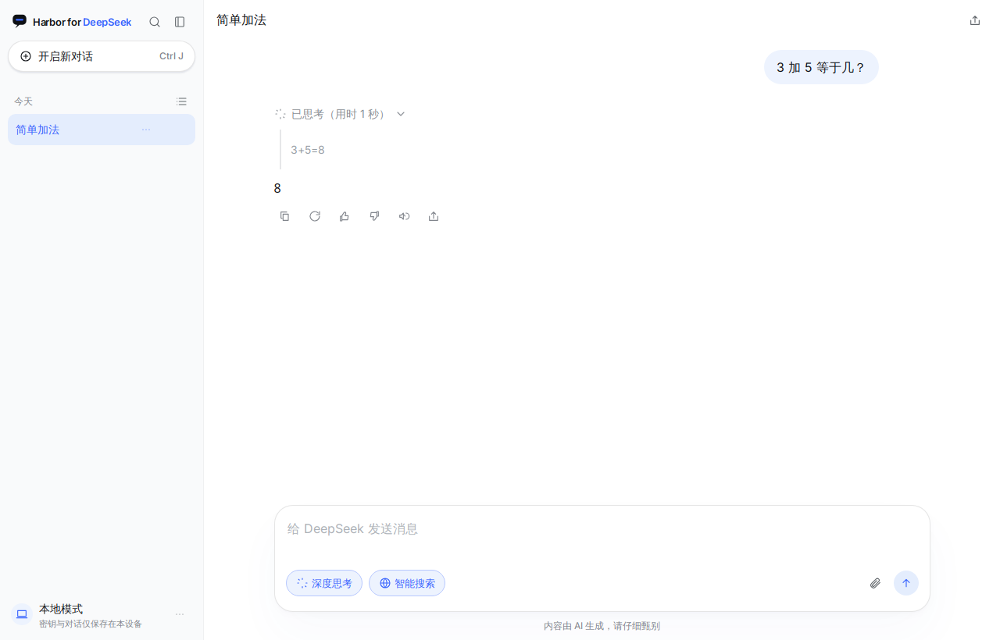
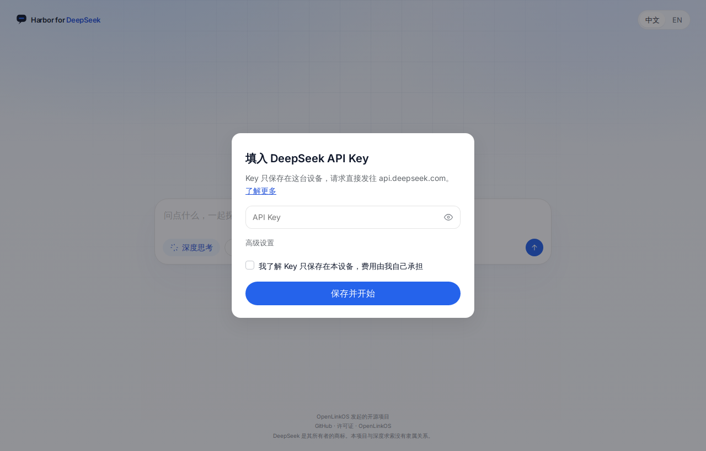
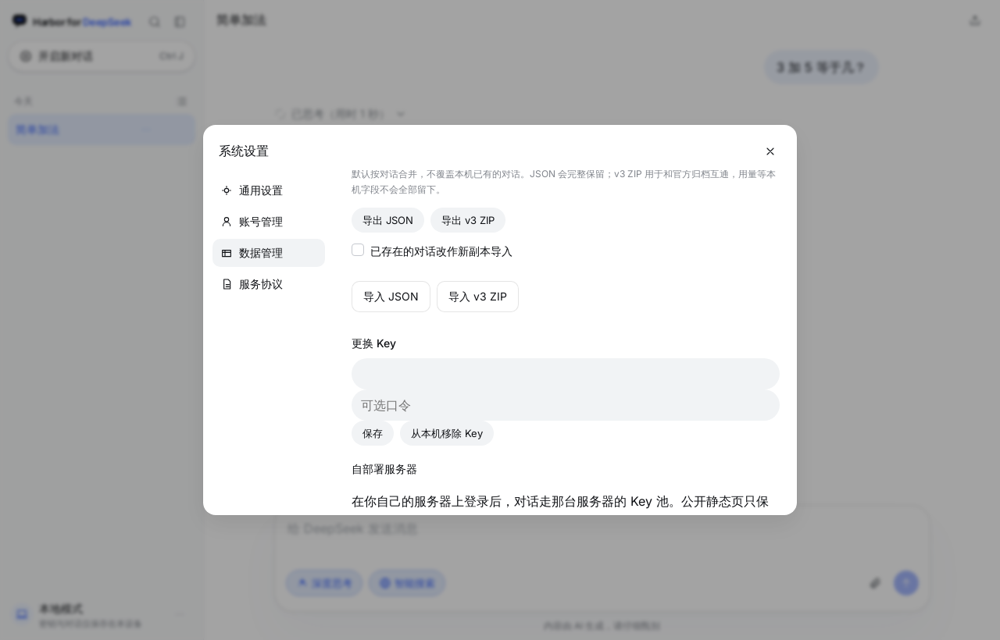

# [DeepAPI](https://deepapi.linkos.org)

DeepAPI 是对接 DeepSeek API 的对话客户端。你使用自己的 Key。

## 功能

### 轻量模式

打开 [deepapi.linkos.org](https://deepapi.linkos.org)，或自行托管静态构建。Key 和消息留在设备上。导出和导入都在本地完成。这种模式没有服务器。

### 服务器模式

可选。用 Docker 和 PostgreSQL 运行你自己的服务器。管理员维护 Key 池、查看余额、创建邀请账号。登录后的人可以在多台设备上同步对话。

## 截图

对话界面，思考过程展开：

填写 API Key 的页面：

在设置里更换 Key：

## 接入 DeepSeek API

1. 打开 <https://deepapi.linkos.org>。
2. 在 <https://platform.deepseek.com/api_keys> 创建 Key，并设置额度。
3. 把 Key 粘贴到第一页，保存在这台设备上。
4. 发送一条消息。浏览器请求 `https://api.deepseek.com`。

自托管服务器：`docker compose pull && docker compose up -d`，在第一页创建管理员，把 Key 加入池中，再把邀请码发给别人。

## 链接

- 主页：<https://deepapi.linkos.org>
- GitHub：<https://github.com/openlinkos/deepapi>
- 许可证：MIT

---

DeepAPI · [OpenLinkOS](https://openlinkos.com/zh/) 发起的开源项目

[GitHub](https://github.com/openlinkos/deepapi) · [OpenLinkOS](https://openlinkos.com/zh/)

DeepSeek 是其所有者的商标。本项目与深度求索没有隶属关系。
